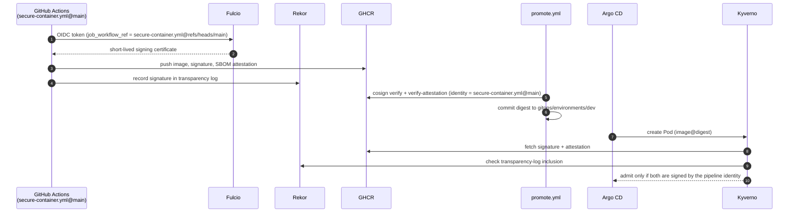

# DevSecOps GitOps delivery pipeline

[](https://github.com/santoshmyakala/devsecops-gitops-pipeline/actions/workflows/ci.yml)


A central, reusable **secure software supply chain** for container workloads, from commit to running pod:

1. **One reusable GitHub Actions workflow** that every application repository calls. It runs secret scanning, SAST, dependency/IaC scanning, the image build, an SBOM, an image vulnerability gate and a smoke test. On `main` it also pushes, **signs keylessly with Sigstore** and attests the SBOM.
2. **A promotion gate** that writes an image digest into a GitOps environment only after verifying its signature and SBOM attestation. Prod only accepts the digest that dev is running.
3. **Argo CD (app-of-apps)** deploying each application's Helm chart **straight from its own repository**, with environment values held here.
4. **Kyverno admission policies (CEL)** that enforce pod security and only admit images **signed by this pipeline's workflow identity**.

The first consumer is [wine-quality-mlops](https://github.com/santoshmyakala/wine-quality-mlops): its CI trains and tests the model, then hands the container to this pipeline.

## Architecture

### End to end

<picture>
  <source media="(prefers-color-scheme: dark)" srcset="docs/diagrams/supply-chain-dark.svg">
  
</picture>

### Pipeline stages and gates

<picture>
  <source media="(prefers-color-scheme: dark)" srcset="docs/diagrams/gates-dark.svg">
  
</picture>

### Trust chain: why a pod gets admitted



The signing identity is the **reusable workflow**, not the calling repository. A developer can't produce an admissible image by building on a laptop or in an ad-hoc workflow. It has to go through every gate above.

## Controls

| Threat | Control | Where |
|---|---|---|
| Credentials committed to git | gitleaks on the full history; fails the build | `secure-container.yml` → `secrets` |
| Vulnerable code patterns | Semgrep SAST, results uploaded to GitHub code scanning | `sast` |
| Vulnerable dependencies, misconfigured Dockerfile/Helm/Terraform | Trivy fs (`vuln,misconfig,secret`), fixable HIGH/CRITICAL fail | `trivy-fs` |
| Vulnerable OS packages in the image | Trivy image gate before anything is pushed | `build` |
| Unknown image contents | SPDX SBOM, signed as an in-toto attestation | `build` |
| Tampered or substituted image | Keyless cosign signature; Kyverno verifies identity, issuer and Rekor inclusion; tags rewritten to digest | `verify-image-signatures.yaml` |
| Untested change reaching prod | Promotion gate: signature check, prod ← dev digest only, optional required reviewers on the `prod` environment | `promote.yml` |
| Configuration drift | Argo CD auto-sync with self-heal (dev); manual sync (prod) | `gitops/argocd/apps` |
| Container escape / privilege abuse | Deny privileged, root, privilege escalation | `policies/kyverno` |
| Noisy neighbours / unpredictable scheduling | Require CPU/memory requests and a memory limit | `require-resources.yaml` |
| Mutable deployments | Deny `:latest` and untagged images | `disallow-latest-tag.yaml` |
| Unhealthy pods receiving traffic | Require liveness and readiness probes | `require-probes.yaml` |
| Compromised CI dependency | Every third-party action pinned to a full commit SHA; tool downloads checksum-verified | all workflows |

More detail: [docs/threat-model.md](docs/threat-model.md).

## Repository layout

```
.github/workflows/
  secure-container.yml   # reusable secure delivery workflow (workflow_call)
  promote.yml            # signature-gated GitOps promotion (workflow_dispatch)
  ci.yml                 # tests for this repo: lint, policy tests, chart conformance, kind e2e
policies/
  kyverno/               # ValidatingPolicy + ImageValidatingPolicy (policies.kyverno.io/v1, CEL)
  tests/                 # kyverno CLI unit tests and e2e admission fixtures
gitops/
  argocd/root.yaml       # app-of-apps
  argocd/apps/           # AppProject + one Application per environment (multi-source Helm)
  environments/{dev,prod}/  # values written by promote.yml
scripts/
  bootstrap-kind.sh      # local cluster with Kyverno + Argo CD
  e2e-admission.sh       # admission assertions via server-side dry run
docs/threat-model.md
```

## Using the pipeline from an application repo

```yaml
jobs:
  secure-delivery:
    uses: santoshmyakala/devsecops-gitops-pipeline/.github/workflows/secure-container.yml@main
    permissions:
      contents: read
      packages: write          # push to GHCR
      id-token: write          # Sigstore keyless signing
      security-events: write   # upload SARIF
    with:
      image-name: my-service
      artifact-name: build-output            # optional: artifact from an earlier job
      smoke-command: ./scripts/smoke-test.sh # optional: $IMAGE holds the local tag
      push: ${{ github.event_name == 'push' && github.ref == 'refs/heads/main' }}
```

Then promote, either from the Actions tab or with the CLI:

```bash
gh workflow run promote.yml -f environment=dev -f digest=sha256:<from the job summary>
```

```bash
gh workflow run promote.yml -f environment=prod   # promotes whatever dev is running
```

## Testing

| Layer | What is checked | Where it runs |
|---|---|---|
| Workflows and scripts | actionlint, shellcheck | CI |
| Secrets | gitleaks over the full history | CI |
| Policy logic | `kyverno test policies/tests`: 13 cases, compliant and violating Deployments and Pods | CI and locally |
| Real workload conformance | The wine-quality Helm chart is rendered with the **dev and prod values Argo CD uses**, validated with kubeconform and checked against every pod-security policy | CI |
| GitOps manifests | Argo CD `Application`/`AppProject` validated against CRD schemas | CI and locally |
| Admission in a live cluster | kind + Kyverno 1.20: a compliant pod is admitted; privileged, root/`:latest` and **unsigned GHCR images are denied**; once a digest is promoted, the **signed image is admitted** | CI |

Local policy test output:

```
$ kyverno test policies/tests
Test Summary: 13 tests passed and 0 tests failed

$ kyverno apply policies/kyverno/... --resource policies/tests/resources/workloads.yaml
policy disallow-privileged -> resource apps/Deployment/bad-privileged failed
policy require-non-root -> resource apps/Deployment/bad-root-latest-noprobes failed
policy disallow-privilege-escalation -> resource apps/Deployment/bad-root-latest-noprobes failed
policy disallow-latest-tag -> resource apps/Deployment/bad-root-latest-noprobes failed
policy require-probes -> resource apps/Deployment/bad-root-latest-noprobes failed
policy require-resources -> resource apps/Pod/bad-no-resources-untagged failed
policy disallow-latest-tag -> resource apps/Pod/bad-no-resources-untagged failed
pass: 16, fail: 7
```

## Run it locally

Requires Docker, kind and kubectl.

```bash
./scripts/bootstrap-kind.sh
```

```bash
./scripts/e2e-admission.sh
```

Pulling from GHCR without credentials requires the package to be public: GitHub → Packages → `wine-quality-mlops` → Package settings → Change visibility.

## Design notes

- **Kyverno 1.20 removed the legacy `kyverno.io/v1 ClusterPolicy`.** These policies use the CEL-based `ValidatingPolicy` and `ImageValidatingPolicy` (`policies.kyverno.io/v1`), discovered by testing against the 1.20 CLI.
- **Multi-source Argo CD applications** keep the chart with the application code and the environment state here. Promotion is therefore a one-line, reviewable Git change.
- **Digest, not tag.** Environments pin `image.digest`, and Kyverno also rewrites tags to verified digests.
- **PRs never publish.** Pull requests run every scan, but nothing is pushed or signed.

## Roadmap

- [ ] SLSA build provenance attestation (`actions/attest-build-provenance`) verified at admission.
- [ ] Argo CD Image Updater or Renovate to open promotion PRs automatically.
- [ ] DAST (OWASP ZAP baseline) against the dev environment after sync.
- [ ] Runtime detection with Falco; policy reports in Grafana.

## Licence

MIT
